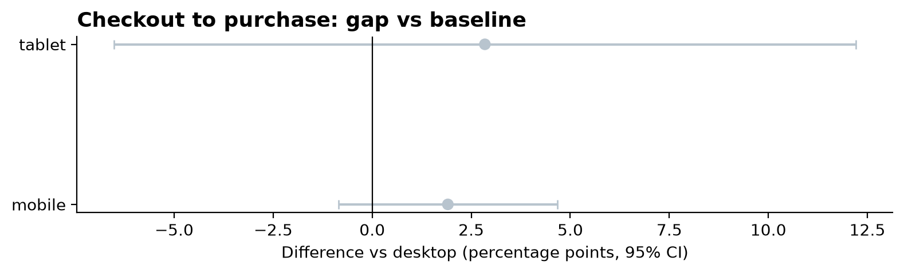
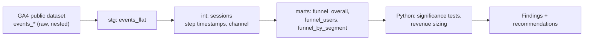

# Where Google Merch Store Shoppers Drop Off: GA4 Funnel Analysis in BigQuery


 

**TL;DR**
- Modeled **4.3M events from 270K users** (360K sessions, Nov 2020 – Jan 2021) of Google Merchandise Store GA4 data in BigQuery.
- Biggest leak: **product view → add to cart**, where **80% of sessions drop off**. **Paid Search** converts **14.1 pts worse than Organic Search** at cart → checkout (23.2% vs 37.3%; 95% CI −19.1 to −9.1, significant after FDR correction).
- Closing half of the Paid Search gap to the overall rate would add about **7 orders (~$460) per quarter** in this sample (range $230–$925).
- Contrary to the usual assumption, **mobile converts as well as desktop** and there's no significant device gap at any step.

## Business Question
- The Google Merchandise Store wants to know where shoppers abandon the path from viewing a product to buying it, and which devices and channels underperform.

## Key Findings

### 1. Only 1 in 5 product viewing sessions add to cart, making it the largest leak in the funnel.
Of 77,030 sessions that viewed a product, only 19.7% added to cart, so about 61,900 sessions were lost at that step. Later steps convert much better: 35% of carts reach checkout and 52% checkouts complete. End to end, 3.6% of product-viewing sessions buy in order.


### 2. Paid Search shoppers stall between cart and checkout.
Paid search sessions that add to cart reach checkout 23.2% of the time, vs 37.3% for Organic Search (-14.1 pts, 95% CI -19.1 to -9.1, BH-adjusted p < 0.001, Cohen's h = -0.31). End to end, Paid Search converts at less than half the Organic rate (1.4% vs 3.2% view to purchase). Direct (-9.5 pts) and unattributed traffic (-7.1 pts) also lag at this step, while Referral is the strongest channel at checkout (62.7% completion vs 46.1%).


### 3. Buying a product takes multiple visits, and returning visitors convert about 3x better.
Returning visitors convert at 6.7% from product view to purchase, vs 2.1% for new visitors, and complete checkout 62.5% of the time vs 41.4 (+21.1 pts, 95% CI 18.5 to 23.8, h = 0.43, the largest effect in the data). Purchasers average 3.6 sessions vs 1.3 for non-purchasers. About half of checkout sessions (52%) skip earlier funnel steps in that same visit, which suggests shoppers add to cart on one visit and come back later to buy.

### 4. Device isn't the problem
Mobile and tablet show no statistically significant difference from desktop at any funnel step. Mobile checkout abandonment is 0.96x desktop's (95% CI 0.91-1.02), so a mobile checkout redesign is not supported by this data. 



## Recommendations
| # | Recommendation | Evidence | Est. impact (quarter) | How to validate |
|---|---|---|---|---|
| 1 | Audit the Paid Search journey: check that ads land on matching product pages, and test the cart page for paid traffic (e.g. surface shipping costs earlier) | Paid Search cart → checkout 14.1 pts below Organic, significant | ~7 extra orders, ~$460 at 50% gap closure (range $230–$925); modest because Paid Search is low-volume in this sample | A/B test on Paid Search traffic; primary metric cart → checkout |
| 2 | Bring new visitors back: keep carts across visits and send cart-reminder emails / showing products again | Returning visitors convert ~3x new; ~half of checkouts happen without a cart add in visit | Not sized | Holdout test on cart-reminder emails; metric 7-day return-and-purchase rate |
| 3 | Do not prioritize mobile checkout design | No significant device gap; mobile abandonment 0.96x desktop (CI includes 1) | Avoided cost | Re-check after the next quarter of data |

## Approach

- Sessions keyed on `user_pseudo_id` + `ga_session_id`; funnel steps stored as first timestamps
- Closed funnel compared with open and user-level funnels
- Segment gaps tested with two-sided z-tests, CIs, and BH correction, with Cohen's h as effect size
- Revenue sizing: gap to the overall (pooled) benchmark × 25/50/100% closure × downstream conversion × segment AOV

  ## Data
   **Source:** [`bigquery-public-data.ga4_obfuscated_sample_ecommerce`](https://developers.google.com/analytics/bigquery/basic-queries), Google Merchandise Store, Nov 1, 2020 – Jan 31, 2021 (92 days).
- **Volume:** 4,295,584 events, 270,154 users, 360,129 sessions (1.3 sessions per user).
- **Funnel events present:** `view_item` → `add_to_cart` → `begin_checkout` → `purchase`, plus `add_shipping_info` and `add_payment_info`.
- **Session IDs:** 0% of events lack a session ID.
- **Channels:** 74% of sessions have session-level source/medium; the rest fall back to first-touch. 14% of sessions have an obfuscated medium (`<Other>` / `(data deleted)`), kept as an "Unknown / obfuscated" channel so totals reconcile.
- **Orders:** 5,692 purchase events, 4,452 distinct transaction IDs and 906 purchases with no ID. Orders are counted as distinct transaction IDs per session, so duplicates count once.
- **Revenue** is obfuscated sample data, so dollar figures are illustrative.

  ## Assumptions and Limitations
  - Paid Search visitors may have lower purchasing intent, so gaps show where to test, not proven causes.
  - Sessions aren't fully independent, so p-values are optimistic.
  - Obfuscated sample means revenue data values are illustrative. We have 330 purchases that share a transaction ID.
  - Window for data is 92 days during holiday peak, so figure is an upper bound
 
  ## Repo structure
```text
ga4-funnel-analysis/
├── README.md
├── Makefile                     # make tables / make test
├── requirements.txt
├── conftest.py
├── .github/workflows/tests.yml  # CI
├── sql/
│   ├── 00_exploration/          # profiling queries
│   ├── 01_staging/              # stg_events_flat.sql
│   ├── 02_intermediate/         # int_sessions.sql
│   ├── 03_marts/                # funnel_overall, funnel_users, funnel_by_segment
│   └── tests/                   # test_sessions.sql (ASSERT checks)
├── src/
│   ├── config.py · bq.py · build_tables.py
│   ├── charts.py · stats.py · opportunity.py
├── notebooks/
│   ├── 01_exploration.ipynb
│   └── 02_analysis.ipynb        # funnel → stats → sizing
├── data/processed/              # result CSVs
├── reports/figures/             # charts used above
└── tests/                       # test_stats.py, test_opportunity.py
```
 
## How to reproduce
```bash
git clone https://github.com/brittneychan/ga4-funnel-analysis.git && cd ga4-funnel-analysis
python -m venv .venv && source .venv/bin/activate
pip install -r requirements.txt
cp .env.example .env              # add your GCP project id
gcloud auth application-default login
make tables                       # staging → sessions → marts, then data tests
make test                         # unit tests
jupyter lab                       # run notebooks 01 and 02 in order
```
 
    
