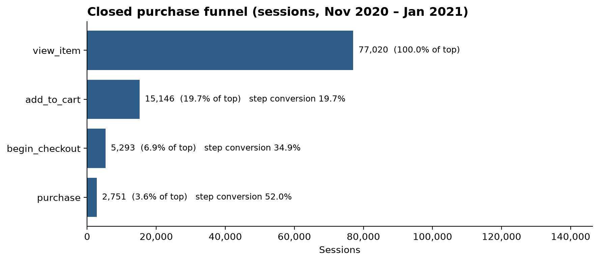
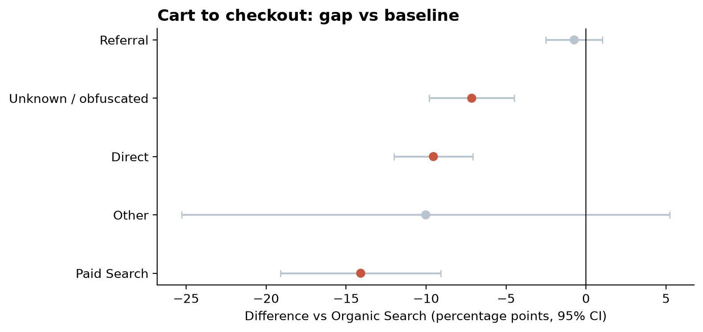

# Where Google Merch Store Shoppers Drop Off: GA4 Funnel Analysis in BigQuery

 

**TL;DR**
- Modeled **4.3M events from 270K users** (360K sessions, Nov 2020 – Jan 2021) of Google Merchandise Store GA4 data in BigQuery.
- Biggest leak: **product view → add to cart**, where **80% of sessions drop off**. **Paid Search** converts **14.1 pts worse than Organic Search** at cart → checkout (23.2% vs 37.3%; 95% CI −19.1 to −9.1, significant after FDR correction).
- Closing half of the Paid Search gap to the overall rate would add about **7 orders (~$460) per quarter** in this sample (range $230–$925).
- Contrary to the usual assumption, **mobile converts as well as desktop** and there's no significant device gap at any step.

## Business Question
- The Google Merchandise Store wants to know where shoppers abandon the path from viewing a product to buying it, and which devices and channels underperform.

## Key Findings

### 1. Only 1 in 5 product viewing sessions add to cart, making it the largest leak in the funnel.
Of 77,030 sessions that viewed a product, only 19.7% added to cart, so about 61,900 sessions were lost at that step. Later steps convert much better: 35% of carts reach checkout and 52% checkouts complete. End to end, 3.6% of product-viewing sessions buy in order.

### 2. Paid Search shoppers stall between cart and checkout.
Paid search sessions that add to cart reach checkout 23.2% of the time, vs 37.3% for Organic Search (-14.1 pts, 95% CI -19.1 to -9.1, BH-adjusted p < 0.001, Cohen's h = -0.31). End to end, Paid Search converts at less than half the Organic rate (1.4% vs 3.2% view to purchase). Direct (-9.5 pts) and unattributed traffic (-7.1 pts) also lag at this step, while Referral is the strongest channel at checkout (62.7% completion vs 46.1%).

